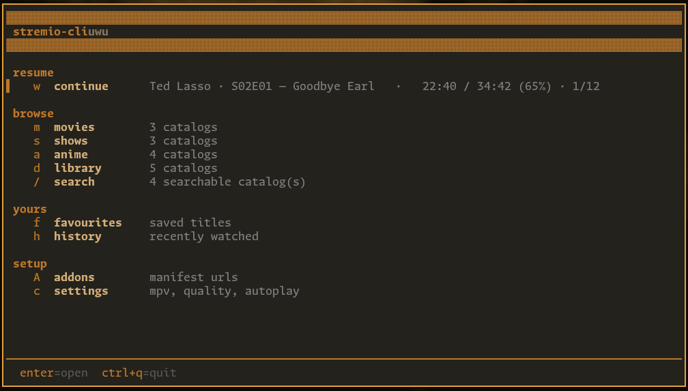

# stremio-cliuwu

A terminal Stremio client. Browse your addons' catalogs, pick a stream, and it
plays in mpv. Keeps track of what you've watched and where you got to.

[](https://o3o.lol/PfG3bI.mp4)

CLICK SCREENSHOT FOR VIDEO DEMO

> **Updating from before v0.6.8?** Your addons, favourites and history moved out
> of `~/.config`. Run this once:
>
> ```
> mkdir -p ~/.local/share/stremio-cliuwu ~/.local/state/stremio-cliuwu && mv ~/.config/stremio-cliuwu/{addons,favourites}.json ~/.local/share/stremio-cliuwu/ ; mv ~/.config/stremio-cliuwu/{history,downloads}.json ~/.local/state/stremio-cliuwu/
> ```

## Install

Grab a binary from [releases](https://github.com/ilovealienz/stremio-cliuwu/releases),
or build it yourself:

```
git clone https://github.com/ilovealienz/stremio-cliuwu
cd stremio-cliuwu
go build -o stremio-cliuwu .
```

You'll need [mpv](https://mpv.io) installed. That's the only requirement.

## First run

Two things to set up, both take a minute.

### 1. Point it at mpv

Open **settings** (press `c` from the main menu) and check the **mpv path**.

Most of the time it'll have found mpv already and you can ignore this. If it
says `—` or you get "mpv not found", set it manually:

- **Linux / macOS** — usually just leave it blank, `mpv` is on your PATH
- **Windows** — paste the full path to the exe, something like
  `C:\Users\YourName\mpv\mpv.exe` or `C:\Program Files\mpv\mpv.exe`

### 2. Add your addons

Cinemeta, Kitsu and OpenSubtitles v3 come pre-installed so you can browse
straight away, but you need a **stream addon** (Torrentio, etc) before anything
will actually play.

To get an addon's URL:

1. Go to [web.stremio.com/#/addons](https://web.stremio.com/#/addons)
2. Find the addon you want, hit **Share**
3. Copy the link it gives you

Then in stremio-cliuwu:

1. Press `A` (shift+A) for the **addons** screen
2. Press `a` to add
3. Paste it — `ctrl+shift+v` on Linux, `ctrl+v` on Windows
4. Enter

That's it. Press `r` if you want to re-check that they all loaded.

Addon order matters — stream results are grouped in the order listed, so put
your favourite on top with `J` / `K`.

> Addon URLs often have your debrid API key baked into them, so treat
> `addons.json` like a password file. The app blurs the key when it shows a URL
> and writes the file `0600`.

## Getting around

Arrow keys and enter get you everywhere. The footer always shows what the
current screen can do.

| | |
|---|---|
| arrow keys | move up and down, left and right to page |
| `enter` | open |
| `b` or `esc` | back |
| `/` | filter the list |
| `0-9` | jump straight to a numbered stream |
| `i` | show info for whatever's highlighted |
| `S` | subtitles for what's playing |
| `tab` | switch provider / category |
| `X` | stop mpv |
| `ctrl+q` | quit |

If you're a vim person, `j` `k` and `ctrl+u` `ctrl+d` work too.

From the main menu you can jump straight to things: `m` movies, `s` shows,
`a` anime, `d` library, `/` search, `f` favourites, `h` history, `D` downloads,
`A` addons, `c` settings, `w` continue watching.

On an episode list, `w` marks one watched and `W` does the whole season. On a
catalog, `g` picks a genre. On a stream, `D` downloads it, `n` queues it to play
next, and `[` `]` move between episodes.

Pause and seek aren't bound — do that in the mpv window, it's right there.

## From the command line

```
stremio-cliuwu                     the main menu
stremio-cliuwu chuunibyou          search for it
stremio-cliuwu -a chuunibyou       search anime only
stremio-cliuwu -sf -a chuunibyou   ...and open the first hit
stremio-cliuwu -m                  browse movies
```

`-m` movies, `-t` shows, `-a` anime, `-s` search, `-sf` search and open the
first result. `--help` for the rest.

## Bits worth knowing

**Cached streams float to the top.** Torrentio marks instantly-available
debrid results with `⚡`. Uncached ones need downloading first, so they get
sorted below. Turn it off in settings if you'd rather not.

**It picks up where you left off.** Continue watching is on the main menu, and
selecting something you've partly watched asks whether to resume or start over.

**Next episode loads itself.** Near the end of an episode it fetches the next
one's streams and puts them on screen, so when the current one ends you just
pick and go. Or let [autoplay](#autoplay) pick for you.

**Watched isn't a flat percentage.** A ten minute cartoon and a two hour film
shouldn't need the same fraction watched to count as finished, so the
threshold scales with runtime.

**`i` opens an info panel** with the synopsis, cast and rating — on catalogs,
seasons and episodes. It opens itself on a wide enough terminal. Posters are
real images on kitty and Ghostty, block art everywhere else. The next few rows
below the cursor load ahead of time so they don't pop in; set how many under
**preload ahead** in settings, or turn it off.

**`S` picks subtitles** while something's playing, from any addon that
serves them. It opens on whatever you've set as your subtitle language —
that setting takes a list, so `eng, en, English` all count as English.

**`D` downloads a stream.** One at a time, resumable, into a folder layout you
can change in settings. Progress shows at the bottom wherever you are. On the
downloads screen `x` stops one and `enter` picks it back up, `D` deletes it.

## Autoplay

Press `a` on an episode's stream list to turn it on. It's meant to be used with
your own filter: press `/` and narrow the list to what you want, like a release
group, `2160p` or `dual`, then pick a stream. The filter and the addon tab
carry over to the next episode, and autoplay plays the closest match there: the
same language and audio, then the same quality and group where it can.

It stops at the end of a season, and if nothing in the filtered list fits, it
opens the list for you to choose.

## Heads up

I daily drive this on Linux, so that's what gets the most use. Windows works
fine as far as I can tell, it just doesn't get tested as much — if you hit
something odd there, [open an issue](https://github.com/ilovealienz/stremio-cliuwu/issues)
and I'll take a look.

Worth knowing on Windows: use Windows Terminal rather than the old `cmd`
console, otherwise some of the characters come out as boxes.

And one that isn't a bug — debrid links expire after a while. If a stream won't
open, press `R` on the stream list to fetch fresh ones.

## Config

Everything is in `%APPDATA%\stremio-cliuwu\` on Windows.

| | |
|---|---|
| `~/.config/stremio-cliuwu/config.json` | mpv path, quality, downloads, appearance |
| `~/.local/share/stremio-cliuwu/addons.json` | your addon URLs |
| `~/.local/share/stremio-cliuwu/favourites.json` | |
| `~/.local/state/stremio-cliuwu/history.json` | positions and watched state |
| `~/.local/state/stremio-cliuwu/downloads.json` | |

Everything in `config.json` is editable from the settings screen, so you
shouldn't need to touch these by hand.

## 3.0

Rewritten in [Bubble Tea](https://github.com/charmbracelet/bubbletea).

Also dropped the Stremio account login — it used to sign in and pull your addon
list down, now you just paste the URLs in. Catalogs and search come from your
installed addons rather than being hardcoded, so adding an addon actually adds
something to browse.

## Licence

MIT
